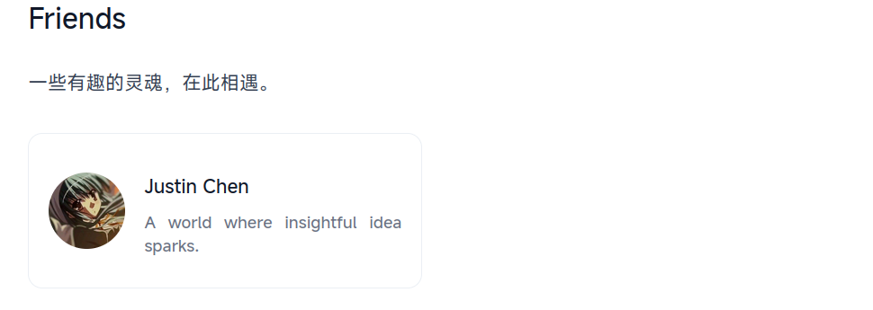

+++
date = '2026-10-16T19:08:39+08:00'
draft = false
title = '为我的博客添加友链功能'
authors = [
  "Chen Pan",
]
+++

我其实很早之前（大概是在完成 blogroll 功能后）就想为我的博客添加友链功能了，迟迟未做的原因是因为
目前现有的 markdown 功能也能勉强展示（其实就是懒），不过它的缺点显而易见，那就是内容太单调，仅仅
展示标题和链接是不够的，我需要它能够展示头像、名称以及个人描述，最好还能自己添加点 CSS 样式。

很幸运，今天故事发生了转折，NixOS群群友 [Justin Chen](https://blog.starryreverie.cc/) 分享了自己的新博客，
我随机瞟了一眼博客的内容和仓库，发现也是由 Hugo 构建的，我遂即将我自己制作的 Hugo 主题 Hugo Paper Lite
分享了出来，然后我就这样参与了交流。

在后面的交流中 Justin Chen 提出互相添加友链，刚看到这条消息，我既欣喜，又有所担心。欣喜的原因是终
于有人找我添加友链了，而过去我也曾在其他地方向他人提出互相添加友链的请求，不过多数都是敷衍了事，
并没有当回事；说到担心，那就是自己的友链功能还未实现。

不过，换个角度来看，这未尝不是一个契机。既然已经有人向我提出了友链交换的请求，那么一直搁置着的友链功能，
也终于有了一个让我下定决心去实现的理由。与其继续依赖单调的 Markdown 列表，不如趁着这个机会，认真设计一下
自己想要的友链页面。

于是，我终于开始着手实现这个搁置已久的功能。对于我而言，这不仅仅是给博客增加一个展示友情链接的页面，
更是希望借此认识更多有趣的人，看看不同的人在网络的角落里记录着怎样的生活、想法与故事。毕竟，博客的
意义或许不只在于表达自己，也在于让原本互不相识的人，有机会通过文字建立起一点联系。

---

关于具体的实现方式，我其实考虑过两种方案：一种是为 Links 页面单独设计一套布局，另一种则是利用 Hugo 的 Shortcodes 来实现。

前者的优点是结构清晰，可以完全按照自己的想法设计页面；但相应地，它也会让友链功能与特定的页面布局绑定在一起。
相比之下，Shortcodes 的灵活性显然更符合我的需求：既可以复用现有的页面布局，又能将友链卡片封装成独立的组件，
之后无论是调整样式，还是在其他页面中使用，都更加方便。

权衡之后，我最终选择了 Shortcodes。这样一来，我只需要在 Markdown 中插入相应的 Shortcode，就能生成包含头像、
名称和个人描述的友链卡片。

```html
<ul class="grid grid-cols-1 gap-4 sm:grid-cols-2 list-none p-0">
    {{ range site.Data.friends }}
    <li class="pl-0">
        <a href="{{ .url }}"
            class="group flex items-center gap-4 rounded-xl px-4 border border-gray-300/80 dark:border-gray-700/80 no-underline"
            target="_blank" rel="noopener noreferrer" aria-label="{{ .name }}">
            

            <div>
                <h4 title="{{ .name }}">
                    {{ .name }}
                </h4>
                <p class="line-clamp-2 text-sm text-gray-500 dark:text-gray-400" title="{{ .description }}">
                    {{ .description }}
                </p>
            </div>
        </a>
    </li>
    {{ end }}
</ul>
```
---

成果展示，看起来不算糟糕，点击 [Links]() 查看更多。



好了这就是本次分享，对我来说总体还算满意，很幸运也很开心。同时也期待更多的友链可以添加进来。
