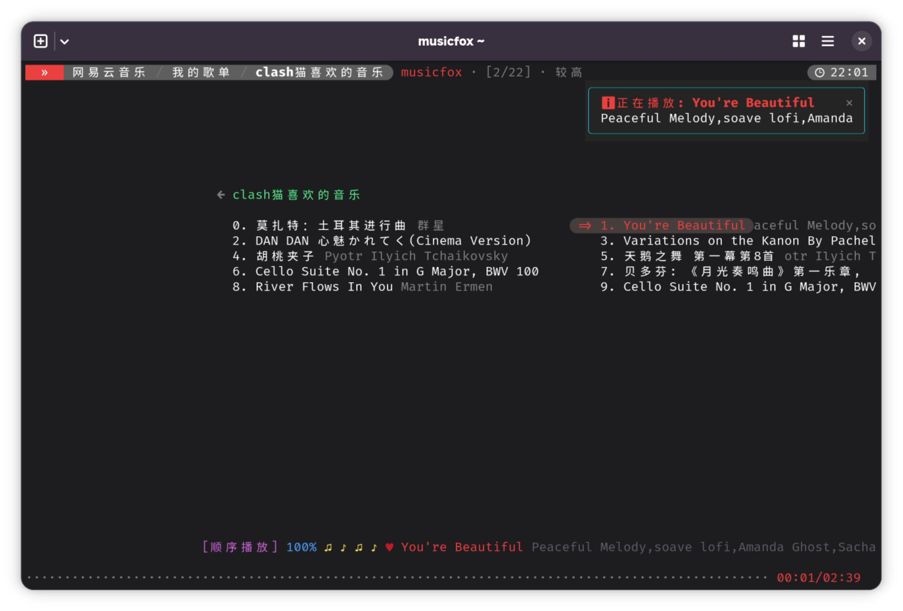
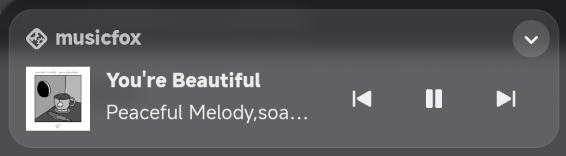
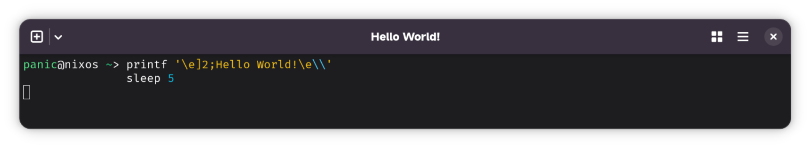

+++
date = '2026-10-21T21:41:52+08:00'
draft = false
title = '如何更改 Terminal 的标题'
authors = [
  "Chen Pan",
]
+++

> 省流：我给 [go-musicfox](https://github.com/go-musicfox/go-musicfox) 修复媒体通知图标缺失的问题的同时
> 添加了更改终端窗口标题的功能。

下面统称 **musicfox**

从 Fedora 换到 NixOS 已经好几个月了，曾经在 Fedora 经常使用网易云音乐命令行客户端 musicfox 忘记装回来了，今天突然想起了这个软件，
遂想把它安装回来。我先查看了它的项目仓库，近几个月添加了很多重要更新。我看到的每一个功能都很喜欢，详细功能请看下面这张图，左上角
添加菜单导航，终于可以使用鼠标快速切换页面，摆脱一级一级退出的痛苦；还有给当前选中的音乐添加了背景，同时背景还设置了圆角，这很现代
好吧；最后还有右上角的通知，我相信这个功能对平铺式窗口管理器用户极为友好。



---

在使用的过程中我发现 musicfox 的媒体通知缺失图标，请看下图的左上角，不知道什么原因，fallback 到了默认的图标。



我排查各种原因，试过手动给他添加 `symbolic` 图标以及 `.desktop` 桌面文件，发现通通都没用。之后发 NixOS 群里求助群友，有一位群友
提出 [mpris](https://specifications.freedesktop.org/mpris/latest/Media_Player.html) 好像可以更改上图中这个图标。我立马搜索并跳转
到了 mpris 的官网，这是一份规范，展示了媒体程序在进行远程控制时（媒体通知的控制也是一种远程控制）应该具备哪些属性。

这是我不了解的领域，我直接将上面的问题经过以及这份文件发给了 DeepSeek，让它帮我分析一下，很快他就给出了以下命令进行排查。


panic@nixos ~> busctl --user get-property \
                     org.mpris.MediaPlayer2.musicfox.instance47038 \
                     /org/mpris/MediaPlayer2 \
                     org.mpris.MediaPlayer2 \
                     DesktopEntry
Failed to get property DesktopEntry on interface org.mpris.MediaPlayer2: The name is not activatable


注意看第6行的错误信息，我随即打开 LibreWolf 对照测试看看。哎，LibreWolf 正常的，那是不是可以锁定问题了呢？


panic@nixos ~> busctl --user get-property \
                     org.mpris.MediaPlayer2.firefox.instance_1_97 \
                     /org/mpris/MediaPlayer2 \
                     org.mpris.MediaPlayer2 \
                     DesktopEntry
s "librewolf"


我无法确定问题到底所在，我之前已经创建了 `.desktop` 文件了啊。我正疑惑着，再次查看 mpris 规范，生怕露了某个属性没写。

>The basename of an installed .desktop file which complies with the Desktop entry specification, with the ".desktop" extension stripped.
>Example: The desktop entry file is "/usr/share/applications/vlc.desktop", and this property contains "vlc" 

啊，原来是 [DesktopEntry](https://specifications.freedesktop.org/mpris-spec/latest/Media_Player.html#Property:DesktopEntry)
属性没写，根据 DesktopEntry 的说明，DesktopEntry 与程序的 `.desktop` 文件对应，与桌面集成相关，并从中获取应用名称和图标提供给
通知中心的媒体控制或是其他地方，我赶紧往 `internal/remote_control/remote_control_linux.go` 里面添加这个属性，就是下面的第7行代码。


func (m *MediaPlayer2) properties() map[string]*prop.Prop {
	return map[string]*prop.Prop{
		"CanQuit":             newProp(true, nil),          // https://specifications.freedesktop.org/mpris-spec/latest/Media_Player.html#Property:CanQuit
		"CanRaise":            newProp(false, nil),         // https://specifications.freedesktop.org/mpris-spec/latest/Media_Player.html#Property:CanRaise
		"HasTrackList":        newProp(true, nil),          // https://specifications.freedesktop.org/mpris-spec/latest/Media_Player.html#Property:HasTrackList
		"Identity":            newProp(types.AppName, nil), // https://specifications.freedesktop.org/mpris-spec/latest/Media_Player.html#Property:Identity
		"DesktopEntry":        newProp(types.AppName, nil), // https://specifications.freedesktop.org/mpris-spec/latest/Media_Player.html#Property:DesktopEntry
		"SupportedUriSchemes": newProp([]string{}, nil),    // https://specifications.freedesktop.org/mpris-spec/latest/Media_Player.html#Property:SupportedUriSchemes
		"SupportedMimeTypes":  newProp([]string{}, nil),    // https://specifications.freedesktop.org/mpris-spec/latest/Media_Player.html#Property:SupportedMimeTypes
	}
}


以及下面的，其实就是按照原来模板补全缺少的属性就好了，非常简单。

```go
{
	Name:   "DesktopEntry",
	Type:   "s",
	Access: "read",
},
```

构建 -> 运行 -> 调试/测试。

```sh
panic@nixos ~> busctl --user get-property \
                     org.mpris.MediaPlayer2.musicfox.instance50223 \
                     /org/mpris/MediaPlayer2 \
                     org.mpris.MediaPlayer2 \
                     DesktopEntry
s "musicfox"
```

好了，终于修好了！！！


---

## 番外

其实我一开始就是想修复上面的问题的，结果被其他东西吸引到了这个功能，就是给终端窗口添加标题，结果也是先完成了这个功能才去修复了
上面那个问题。

我为这个项目安装了一台 Fedora 虚拟机，用来编写代码和测试功能。就在我安装 GNOME Boxes（GNOME 的虚拟机前端）时，我发现 Ghostty 会
在窗口顶部实时显示 Flatpak 的安装进度。我突然对这个小功能产生了好奇：Ghostty 是如何得知 Flatpak 的安装进度的？终端模拟器与命令行
程序之间，究竟是如何传递这类信息的？

我首先查阅 Ghostty 的文档，很幸运，我在那里找到了答案。我发现这背后涉及一个名为 [ConEmu](https://ghostty.org/docs/vt/osc/conemu) 的
终端扩展协议。它允许命令行程序通过特定的转义序列向终端报告任务进度，而终端则可以将这些信息呈现为进度条等视觉反馈。

正是在翻阅文档的时候，我发现了一个可以为 musicfox 提供功能增强的协议 [Change Window Title](https://ghostty.org/docs/vt/osc/2)，看到
这个我立马想到能不能将歌曲名称以及歌手名字展示在终端窗口标题上。

我先是在 Ghostty 进行了简单的测试，通过执行下列命令

``` sh
printf '\e]2;Hello World!\e\\'
sleep 5
```

看看效果，如预期一样，完美。现在只需要简单的编码这个功能就算完成了。


花点时间了解项目结构后，我大致知道在什么地方添加这个功能。因为这属于 `UI` 的逻辑，所以我很快定位到了 `internal/ui/player.go` 这里。
过往的经验告诉我，肯定是在某个生命周期或者钩子函数内添加就好了，不出所料。

``` go
// PlaySong 播放歌曲
func (p *Player) PlaySong(song structs.Song, direction PlayDirection) {
  ...
  // 更改终端窗口标题 https://ghostty.org/docs/vt/osc/2
  fmt.Printf("\x1b]2;%s - %s\x1b\\", song.Name, song.ArtistName())
  ...
}
```

我还挺喜欢这个功能。代码似乎还有些简陋，不过功能总算完成了，期待维护者后续的审查和修改建议。


## 写在最后

写到这里夜已经很深了，今天不仅为这个项目修复了 Bug，还新增了功能，以及编写各种文档，最后还要写完这篇博客。

我想我已经很累了，也不知道该说些什么了，期待这两个 PR 的后续发展。

- [685](https://github.com/go-musicfox/go-musicfox/pull/685)
- [684](https://github.com/go-musicfox/go-musicfox/pull/684)
